  

##  About me

Hello, I'm a systems engineering student who likes building applications for any problem I come across, no matter how small it is, and turning it into a real solution through technology. I'm a competitive person: I enjoy challenges, hackathons and olympiads.

##  Education

-  Systems Engineering – Universidad Mayor de San Simón
- 🇺🇸 English Language Studies – ALDA Foundation

##  Experience

-  Mentor – Olimpiadas STEM+ *(current)*
-  Jala Soft *(current)*
-  Agent – Olimpiadas STEM+
-  OMIE – Instituto Tecnológico Mundial
-  Capacitabol – Capacitación Técnica Innovadora
-  Élite Preuniversitarios

##  Military Service

-  18th Airborne Infantry Regiment Victoria – CITE

 

---

##  Technologies

### Microsoft Power Platform

  
  
  
  

### Languages

  
  
  
  
  
  

### Frontend Stack

  
  
  
  
  

### Mobile

  
  

### Backend Stack

  
  
  
  

### Databases

  
  

### Tools

  
  
  

---

  

